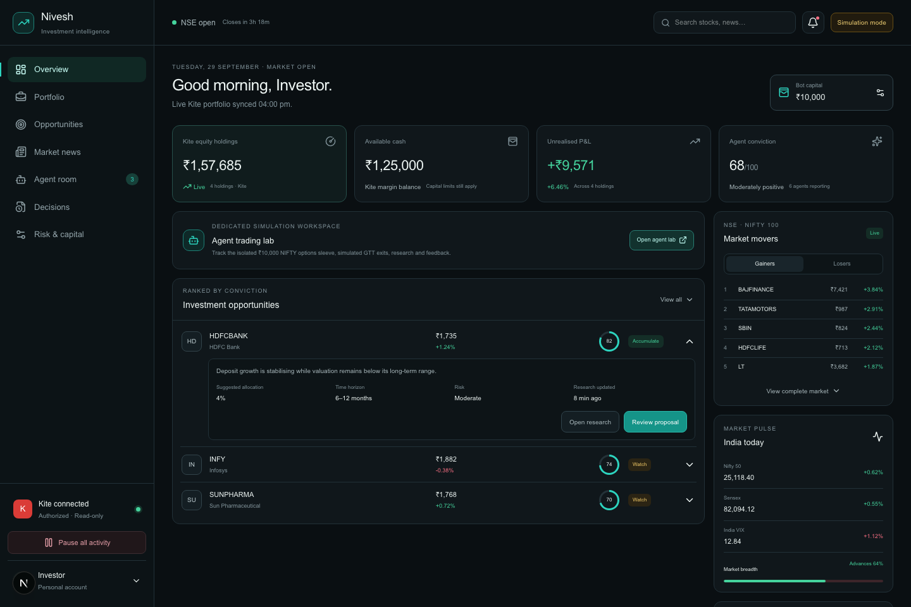
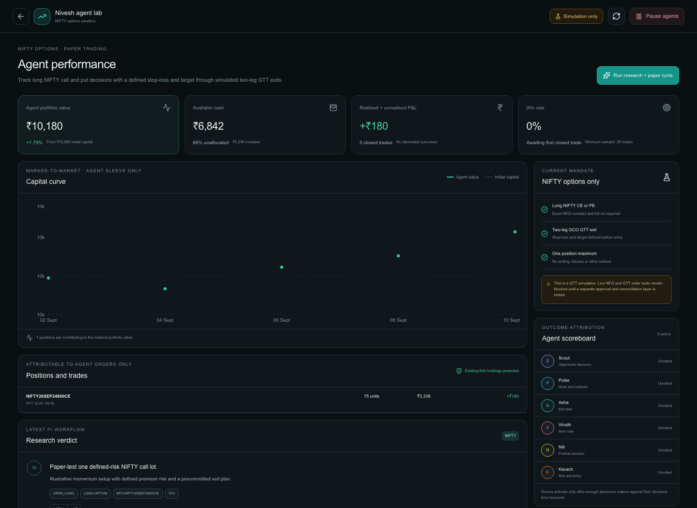
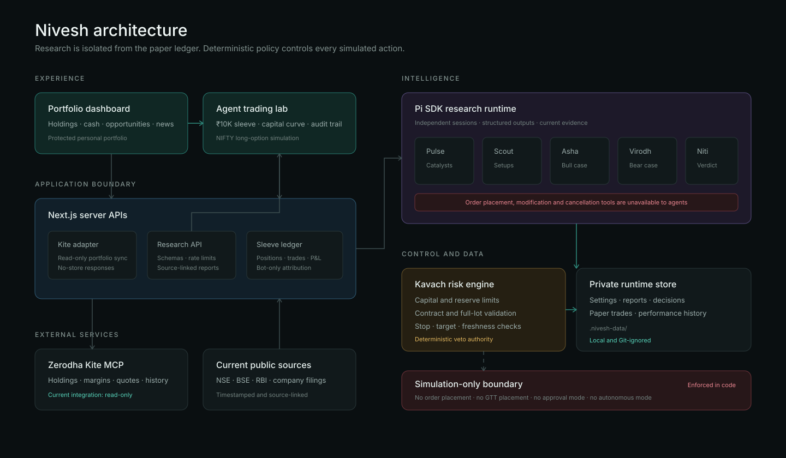

# Nivesh

<p align="center">
  <strong>A cautious, multi-agent investment workspace for Indian markets.</strong><br />
  Portfolio intelligence, current research, deterministic risk controls and an isolated NIFTY options laboratory.
</p>

<p align="center">
  
  
  
  
  <a href="LICENSE"></a>
  
</p>

> [!WARNING]
> Nivesh is experimental, local-first software. It has no multi-user authentication boundary and must not be exposed to the public internet. Brokerage integration is read-only; the application does not implement live trading.
>
> The screenshots and explicitly labelled dashboard examples use fictional fixtures. They contain no brokerage account data, real holdings, credentials or live trading signals. Actual portfolio and research data appear only after Kite synchronization or a completed research run.

## Dashboard

The main workspace combines the protected personal portfolio with capital controls, opportunities, market context and access to the isolated agent lab.



## Agent trading lab

`/agent` tracks the dedicated bot sleeve independently from existing holdings: marked-to-market capital, paper positions, research verdicts, GTT exit plans and the risk-engine audit trail.



## Architecture

Research and simulation are intentionally separated. Pi agents collect evidence and submit schema-validated reports, but they cannot call brokerage execution tools. Kavach applies deterministic policy before anything reaches the paper ledger. The application contains no live-order execution path.



## Current capabilities

- Minimal three-tab workspace: Overview, Agents and Algorithms
- Combined holdings/performance overview with top-level 1/3/7/30-day, 6-month and 1-year equity health comparisons
- Cash-constrained, equal-weight rebalancing illustrations with quantities and amounts
- NIFTY/BANKNIFTY option paper algorithms: opening-range breakout, EMA crossover and RSI momentum
- Compact holdings-table buy summaries and price-based verdict popovers without expanding rows
- Read-only mutual-fund holdings below equities, with separate valuations, NAVs, fractional units, folios and sorting
- Persistent activity history, completed research reports and JSON log export
- Configurable, persistent bot-capital sleeve
- Official Kite MCP authentication and read-only portfolio synchronization
- No-store responses for sensitive portfolio APIs
- On-demand research powered by independent Pi SDK sessions
- Pulse, Scout, Asha, Virodh, Niti and Kavach specialist roles
- Current web/Kite evidence with structured, source-linked reports
- Tool-call allowlists and interception around every research session
- Dedicated `/agent` performance and decision workspace
- NIFTY long-option paper engine
- Exact NFO contract and complete lot-size validation
- Simulated costs, slippage, stop-losses, targets and time exits
- Simulated two-leg OCO GTT protection using `NRML`
- Explicit executed, rejected and no-action audit records
- Persistent pause control shared by both workspaces
- Versioned, atomic runtime state with backup recovery and stale-write detection
- Loopback-only network boundary and same-origin mutation checks
- Automated policy, persistence and request-security tests
- Existing Kite holdings protected from bot attribution and selling

## Portfolio analysis and index-option algorithms

The default `/` view combines holdings, unrealised P&L, cash, portfolio health and separate paper performance. **Analyse portfolio** fetches up to 450 calendar days of daily Kite history for current holdings plus optional candidate symbols. Successful instrument history is cached for 15 minutes; old short-history caches are upgraded automatically. The top-level **Portfolio health** selector offers 1d / 3d / 7d / 30d / **6M / 1Y**, without adding long-term columns to equity or mutual-fund tables.

Short periods use calendar days. Six months and one year use calendar-month/year subtraction, clamping month ends and leap dates (31 October → 30 April; 29 February → 28 February in a non-leap year). Baselines use the last available daily close on/before that reference date, no more than seven calendar days earlier. The top-level view shows percentage movement, hypothetical rupee value change and coverage of current equity holdings. Current quantities are held constant and percentages use total reconstructed baseline value, not a simple average of stock returns. Candidate stocks with zero units are excluded.

These are **equity price comparisons, not actual historical account profit**, cash-flow-adjusted returns, annualised performance, XIRR or peak drawdowns. Cash, mutual funds, dividends, fees, realised trades and paper algorithms are excluded. Actual account profit needs complete transaction/cash-flow history; the mutual-fund holdings endpoint does not provide historical NAV series. Review corporate actions when interpreting long-term prices. If any held equity lacks a valid quote or period baseline, that period's aggregate change remains unavailable with a coverage warning—never a misleading partial basket or zero. Saved pre-feature analyses require **Analyse portfolio** once to populate 6M/1Y data.

Quantity suggestions illustrate an equal-weight target with 20% of current cash reserved. Additions share a single cash budget and do not assume reductions have been executed. They are not fundamental stock recommendations and never create orders. The **Agents** tab retains completed evidence reports and recent local events; JSON export includes the paper decision/trade ledger. Up to 1,000 workspace events are retained.

### Holdings: last recorded buy and verdicts

The holdings table replaces its 3-day column with one compact **Last buy** cell: actual executed price/premium, percentage change since that fill, executed units and purchase amount before fees. Hover, focus or tap the cell for execution date, source, trade ID and rupees-per-unit movement. This is the latest recorded individual delivery BUY fill for that exchange/symbol, not a whole-order aggregation or the return of the entire holding. Holdings' average cost is never substituted.

Buy fills and live holdings refresh automatically approximately once a minute while the connected workspace is open, and on initial load, manual refresh and returning focus. Long-running operations, browser background throttling or provider failures may delay a cycle. **Retry buy sync** and analysis can also request synchronization, with a one-minute cooldown shared by callers. Saved fills remain visible across restarts, empty daily tradebooks and temporary provider failures. Historical prices alone cannot reconstruct a user's transaction history.

Use **Sort by** or click any table header to sort ascending/descending. Last-buy fields can be sorted independently by execution date, price, units, amount or percentage change; the Last buy header toggles the selected last-buy field (date by default). Other options include stock, quantity, price, holding value, unrealised P&L, 1/7/30-day movement and verdict review priority. Missing/invalid values remain last in either direction, ties use stock/exchange, and sorting never mutates the broker data. The selected sort remains active during refreshes while the table is mounted. Numeric fields use raw values, not currency-formatted strings; row heights remain unchanged.

For older purchases, **Import older buys** accepts a Console CSV with Symbol/Tradingsymbol, Exchange, Trade Type/Transaction Type, Quantity, Price/Average Price, Trade ID and Order Execution Time/Fill Timestamp/Exchange Timestamp. Full execution timestamps are mandatory; date-only rows cannot reliably identify the latest fill. Files without Product tags require explicit confirmation that intraday round trips have been filtered out. Product-tagged MIS trades and derivative rows are skipped. Imports merge by execution timestamp and do not overwrite a newer recorded fill with an older one.

Records may be incomplete and do not adjust for corporate actions or reconcile historical lots. The column is deliberately called **last recorded buy**, not a guarantee of complete brokerage history. Movement is per share, not the return of the entire holding. A missing record remains unavailable.

The last column, **Verdict**, applies transparent rules: ≥10% decline prompts a downside review; ≥5% decline, ≥3% daily decline or ≥7% weekly decline pauses additions for review; ≥15% gain prompts profit-taking review; ≥5% gain prompts exposure review. Other recorded-buy movements remain hold/monitor. Old historical snapshots are not used for daily/weekly triggers, and old portfolio quotes require refresh. These are price-based risk checks, not fundamental recommendations, guaranteed signals, or automatic order instructions. The comparison and verdict live only inside the holdings table. Hover/focus/tap the compact Verdict label to show its explanation and optional equal-weight quantity illustration in a body-level floating popover, not inside the table flow or a separate overview card. Table rows remain 64px high; popovers are viewport-clamped and support Escape and outside-click dismissal. Click a cell to pin/unpin its popover.

### Mutual funds

A separate **Mutual funds** section appears directly below equity holdings. `/api/kite/mutual-funds` uses Kite MCP's read-only `get_mf_holdings` tool. It shows scheme/folio positions, fractional units, remaining cost basis, current value, calculated unrealised P&L, absolute return, average purchase NAV, latest NAV/date and pledged units. Summary totals are separate from the equity metrics. Positions in different folios remain distinct.

Click column headers or use the section's sort controls. Hover/focus/tap a scheme for its full folio, ISIN, units, unpledged units, source-reported P&L and valuation details; visible folios are masked. Popovers do not expand the 64px rows. Units show up to four decimals in the table and eight in details; NAVs show up to four decimals. Currency totals are rounded only for display.

The section refreshes with the portfolio and has a **Refresh funds** action. Successful source snapshots are cached server-side for up to five minutes, concurrent requests are deduplicated, and HTTP responses use `no-store`. NAV dates are shown separately from the fetch timestamp: funds are not intraday-priced equities. Failed fund requests retain the last successful on-screen snapshot with a warning and do not block the equity section. Missing numeric fields remain unavailable, rather than becoming zero; incomplete valuations are not silently presented as complete totals.

Only mutual funds exposed by this Kite account are included, not every external AMC/folio account. A holdings response cannot provide XIRR, SIP schedules, transaction dates/history, exit loads, expense ratios or scheme risk ratings. These are explicitly unavailable, not inferred from average NAV. Absolute return is `(current value − cost basis) / cost basis`, not annualised. Unpledged units are not a promise of immediate redeemability. Mutual funds are not submitted to the index-option algorithm engine and have no execution path. Demo schemes are explicitly fictional.

### Ready-to-configure strategy library

The **Algorithms** tab is for **NIFTY or BANKNIFTY options in paper mode only**, not equities or mutual funds. Select an index, preset, isolated paper budget, maximum lots, daily-entry limit, premium stop and premium target. Configurations start disabled. Fixed preset indicators analyse completed **five-minute underlying index candles**, never the option premium chart.

| Preset | Buy a Call (CE) | Buy a Put (PE) | Index-based exit |
| --- | --- | --- | --- |
| 15-minute ORB | Close crosses above the 09:15–09:30 high | Close crosses below the range low | Close returns through the breakout boundary |
| EMA20/50 crossover | EMA20 crosses above EMA50 | EMA20 crosses below EMA50 | Opposite alignment |
| Wilder RSI(14) momentum | RSI crosses above 55 | RSI crosses below 45 | RSI below 50 exits CE; above 50 exits PE |

ORB needs all three five-minute opening-range candles and a later completed breakout candle. EMA/RSI require 100 completed bars for warm-up. Missing, nonconsecutive or stale current candles skip the cycle. Unfinished candles are excluded, and a consumed signal cannot create another entry. The engine fetches up to ten calendar days of five-minute index history; short-lived bar caches deduplicate nearby calls.

For an entry, the engine reads and fully paginates current NFO instrument metadata, validates the exact NIFTY/BANKNIFTY identity, CE/PE type, expiry, strike, lot size and tick size, then chooses the nearest listed expiry **after today** and its closest ATM strike. No expiry-day entries, fabricated trading symbols, fixed lot sizes or assumed weekly expiry calendars. Incomplete/repeated instrument pages fail closed. Instrument chains are cached for up to one hour on the same India calendar day; spot is rechecked after a slow chain lookup.

One long option position per algorithm; no writing, spreads, futures or equity orders. Maximum entry premium including estimated entry charges is 10% of its paper budget, with 20% cash reserved. All positions use complete fetched lots, up to the configured maximum; if one lot cannot fit, the entry is skipped rather than loosening limits. A 5%-of-budget daily loss guard blocks further entries; maximum entries/day defaults to three. Combined active budgets cannot exceed configured paper capital. A valid recent option trade timestamp, bid/ask depth, spread ≤5% and enough best-level units for the full fill are required. Buys use ask and sells use bid, plus adverse 0.15% slippage, tick rounding and illustrative charges (₹20 per simulated order plus 0.055% of premium turnover). This is an estimate, not an exact broker tax/fee model.

Premium stop/target and time exits take precedence over index indicators and still work when historical data is unavailable, provided fresh option depth exists. No new entries from **14:45 IST**; positions are due to exit at **15:15 IST**. Disabling entries still monitors open positions; global pause stops paper execution. An offline or paused app cannot guarantee those exits. Overdue unexpired positions use the next available live paper quote; expired unresolved positions are retained with an error rather than assigned a made-up settlement. Full premium loss, gaps, theta and volatility risk remain possible. No backtest, guaranteed profit or live trading is implied.

Previous stock-algorithm configurations are automatically moved into a disabled **legacy archive**, preserving their positions and historical balances without pretending they were sold or converted into options. Archived budgets/performance are excluded from active index-option totals. The archive and up to 500 paper trade records per active algorithm are included in JSON exports.

Enabled rules poll once per minute while `/` is open. For browser-independent operation, keep the web service running and opt in from another terminal:

```bash
npm run paper:worker
# Optional local port override:
NIVESH_URL=http://127.0.0.1:3001 npm run paper:worker
```

The worker is not started by default and does not enable any rules itself. It requires a running local service and valid Kite authorization. Every worker tick captures executed delivery BUY fills even with no algorithms configured or with paper execution paused; pausing research/simulation does not pause read-only fill capture. To track purchases with the browser closed, keep both the web service and worker running. If neither observes a trading day's fills before Kite's daily tradebook rolls over, that day requires an import; tracking is not an always-on brokerage event subscription. Only one server process should use a data directory; in-process serialization and a one-minute strategy cooldown prevent duplicate browser/worker cycles. Restarting the service preserves positions and rules. Paper stops are checked on cycles, are not broker orders, and cannot guarantee a stop price. Intraday marks are refreshed only when a cycle obtains a fresh quote. This is not a backtester or a live execution system.

Index-option algorithm balances are isolated in `.nivesh-data/workspace.json`. They are separate from the legacy NIFTY sleeve and must not be added together as one funded account. Neither simulation spends brokerage cash or modifies existing holdings.

## Legacy agent-lab NIFTY options mandate

This section describes `/agent` only. The configurable **Algorithms** tab above supports both NIFTY and BANKNIFTY paper options in a separate ledger.

The isolated agent sleeve currently permits only:

- Long NIFTY calls or puts
- One open position at a time
- Exact NFO option contracts
- A complete lot that fits the configured capital and reserve
- A stop-loss and target defined before entry
- A simulated two-leg OCO GTT exit

It rejects equities, futures, BANKNIFTY, FINNIFTY, MIDCPNIFTY, short positions, option writing and incomplete lots.

## Safety model

1. Research agents never receive brokerage credentials or order tools.
2. Current quotes, contract metadata, capital and research freshness are validated outside the model.
3. A deterministic risk engine can veto every proposal.
4. The bot ledger attributes only its own positions and trades.
5. Runtime reports, account settings and portfolio snapshots stay under `.nivesh-data/`, which is Git-ignored.
6. Environment files and credentials are excluded from version control.
7. Brokerage execution methods, modes and environment switches are intentionally absent.

## Run locally

### Prerequisites

- Node.js 22 or newer
- npm
- A locally configured [Pi coding agent](https://github.com/badlogic/pi-mono) and model provider for research workflows
- Optional: a Zerodha account for read-only Kite portfolio synchronization

```bash
git clone https://github.com/jitu2611/nivesh.git
cd nivesh
npm install
cp .env.example .env.local
npm run dev
```

Open [http://127.0.0.1:3000](http://127.0.0.1:3000). The dedicated trading lab is available at [http://127.0.0.1:3000/agent](http://127.0.0.1:3000/agent).

Use only a trusted local machine. Development and production scripts bind to `127.0.0.1`; Proxy rejects non-loopback hosts, and every mutation requires a matching loopback origin and explicit action header. These controls are defense in depth for a single-user local application, not multi-user authentication. The `private` field in `package.json` intentionally prevents accidental npm publication and is unrelated to this repository's visibility.

## Kite authentication

Select **Connect Kite** in the top bar. Authentication happens on the official Kite/MCP page; Nivesh never asks for a Zerodha password or 2FA value.

After authorization, `/api/kite/portfolio` normalizes holdings, margins and positions without caching the response. Imported holdings are protected by default.

## Pi research runtime

A research cycle runs independent Pi sessions for:

```text
Pulse + Scout → Asha + Virodh → Niti → Kavach → paper risk engine
```

Reports are schema-validated, source-linked, rate-limited and persisted locally. Choosing no candidate or rejecting a trade is a valid outcome; the workflow never forces activity.

## Runtime data and environment

Copy `.env.example` to `.env.local`. Never commit the resulting file.

```env
# Optional override; use an absolute private directory.
NIVESH_DATA_DIR=/absolute/path/to/private/nivesh-data
```

The following remain local and excluded from Git:

```text
.env.local
.nivesh-data/workspace.json
.nivesh-data/runtime.json
.nivesh-data/runtime.json.bak
.nivesh-data/latest-research.json
.nivesh-data/latest-research.json.bak
```

Legacy `settings.json` and `bot-sleeve.json` files are migrated into the versioned `runtime.json` state on first use. Writes use a same-directory temporary file, filesystem synchronization and atomic rename. A valid backup is retained for recovery; invalid persisted data causes an explicit error instead of a silent reset.

## Simulation-only boundary

Nivesh deliberately has no live order, GTT or brokerage approval mode. Explicitly enabled NIFTY/BANKNIFTY option algorithms can execute automatically in an isolated paper sandbox only. Kite integration is read-only and is used for portfolio context, contract metadata and current prices. Paper entries and exits affect only the isolated local ledger.

The market clock currently models regular weekday NSE hours and does not maintain an exchange-holiday calendar. Missing fresh quotes never trigger simulated exits.

## Verification

```bash
npm run check        # lint + TypeScript + tests
npm run build
npm audit --audit-level=moderate
```

## Contributing and security

Contributions are welcome; read [CONTRIBUTING.md](CONTRIBUTING.md) before opening a pull request. Please report vulnerabilities privately according to [SECURITY.md](SECURITY.md), not in a public issue.

Nivesh is available under the [MIT License](LICENSE).

## Disclaimer

Nivesh is experimental software, not investment advice. Options can lose their full premium rapidly. Simulated results do not guarantee live performance, and simulated fills or exits do not represent executable market outcomes.
